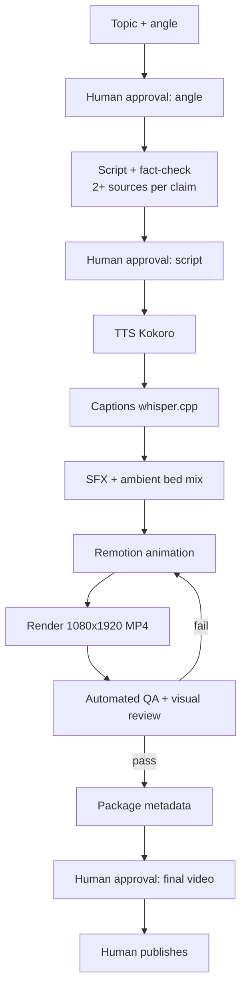

# That's the Mechanism

A local, LLM-agnostic pipeline for vertical explainer Shorts (YouTube, Instagram, TikTok). One everyday object is opened up to show the hidden mechanism. Videos are written and fact-checked here, spoken with local TTS, captioned with whisper.cpp, and rendered as original Remotion animation — no generative video model, no stock b-roll.

This repository is the round-2 state of the channel kit (brand shell, SFX, episode sources, and the scripts that build a Short end to end). It is meant to be driven by **any** coding agent (Claude, Gemini, Cursor, Copilot, Codex, …). Canonical agent instructions live in [`AGENTS.md`](AGENTS.md).

**Nothing in this pipeline publishes.** A human approves the angle, the script, and the final video, then uploads by hand.

## Pipeline



Commands for one episode:

```bash
scripts/new-episode.sh 05-slug CompId sci "HOOK TITLE" "SOURCE"
# write episodes/05-slug/script.txt  (must contain "That's the mechanism.")
# write brief.md, shots.md, sources.json  — then get script approval
scripts/build-episode.sh 05-slug CompId            # TTS → captions → mix → lint → render → QA
scripts/iterate.sh 2 CompId                         # after edits: lint → render → QA
```

Every stage records wall time, CPU time, peak RAM, output size and tool cost ($0) into `metrics/runs.jsonl`.

## Quickstart

Requirements: **Node.js** `^20.19 || ^22.13 || >=24`, **Python 3.10+**, **FFmpeg**, **git**. Full setup also needs **cmake** and a C/C++ toolchain (to build whisper.cpp).

```bash
git clone git@github.com:felipefscalco/thats-the-mechanism.git
cd thats-the-mechanism
scripts/setup.sh --fast          # venv + npm (enough to typecheck)
(cd remotion && npx tsc --noEmit -p .)
# later, for TTS and captions:
scripts/setup.sh                 # also downloads Kokoro + builds whisper.cpp
```

Open the Remotion studio with `(cd remotion && npm run dev)` once episode audio exists under `remotion/public/<slug>.wav` (created by `build-episode.sh`).

## What is in the box

| Path | Role |
|---|---|
| `AGENTS.md` | Canonical instructions for any agent |
| `skills/` | One [Agent Skill](https://agentskills.io) per pipeline stage |
| `docs/STYLE_BRIEF.md` | Channel look, motion, sound, structure |
| `docs/ACCEPTANCE.md` | Automated + visual checklist every episode must pass |
| `remotion/src/brand/` | Shared shell, kit, camera, SFX cues, typography, safe zones |
| `templates/Episode.tsx.tmpl` | Starting composition for a new episode |
| `scripts/` | Scaffold, TTS, captions, mix, lint, render, QA, metrics, setup |
| `episodes/` | Pilot scripts, shot tables, sources, captions (audio is generated, not committed) |
| `sfx/` | Kenney CC0 packs + original synth cues; mapping in `sfx/CREDITS.csv` |
| `metadata.md` | Titles, descriptions, hashtags, pinned comments for the pilot (not uploaded) |

Pilot compositions already registered: `QR`, `Elevator`, `Sky`. `IceDemo` is a **template smoke test only** — not for publishing.

Contact sheets of the approved v2 renders (no MP4s in git): `contact_sheet_v2.png`.

## Metrics (round 2, local box)

All tools are local and free: **cost $0.00**. LLM token counts are not measured by this pipeline. Full tables: [`docs/METRICS.md`](docs/METRICS.md). Typical times for a 40–50 s episode:

| Stage | Wall time | Peak RAM |
|---|---|---|
| TTS (Kokoro) | 7–8 s | ~0.8 GB |
| Captions (whisper.cpp) | 6–7 s | ~1 GB |
| Mix | ~1 s | ~50 MB |
| Render (Remotion, 1080×1920 @ 30 fps) | 26–35 s | ~3.7 GB |
| QA | 39–49 s | ~2.9 GB |

Machine time per finished episode is about **1.5 minutes**, plus however long the visual review and rewrite loop takes. The three published-candidate Shorts took 5–7 QA iterations each.

## Credits and licenses

Code in this repository is **MIT** — see [LICENSE](LICENSE). Asset and dependency terms (Remotion company license, Kenney CC0, Kokoro model, whisper.cpp) are in [LICENSES.md](LICENSES.md).

## Upstream

- [Remotion](https://github.com/remotion-dev/remotion) — renderer
- [HyperFrames](https://github.com/heygen-com/hyperframes) — optional QA helper, not the renderer
- [whisper.cpp](https://github.com/ggml-org/whisper.cpp) — word-level captions
- [kokoro-onnx](https://github.com/thewh1teagle/kokoro-onnx) / [Kokoro](https://github.com/hexgrad/kokoro) — local TTS
- [FFmpeg](https://github.com/FFmpeg/FFmpeg)
- [Kenney](https://kenney.nl/assets/) — CC0 sound effects
