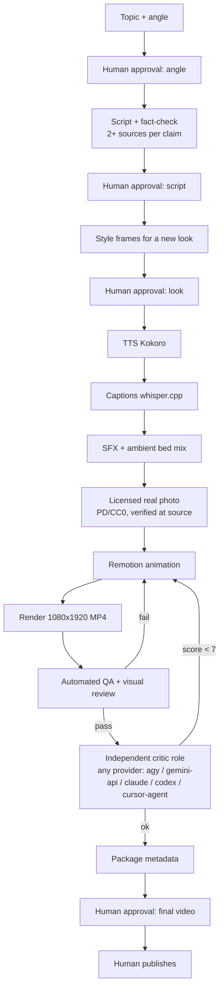

# That's the Mechanism

A local, LLM-agnostic pipeline for vertical explainer Shorts (YouTube, Instagram, TikTok). One everyday object is opened up to show the hidden mechanism. Videos are written and fact-checked here, spoken with local TTS, captioned with whisper.cpp, and rendered as original Remotion animation — no generative video model, no stock b-roll.

This repository is the channel kit (round 7) (brand shell, SFX, episode sources, and the scripts that build a Short end to end). It is meant to be driven by **any** coding agent (Claude, Gemini, Cursor, Copilot, Codex, …). Canonical agent instructions live in [`AGENTS.md`](AGENTS.md), including the [enforcement hierarchy: code over prose](AGENTS.md#enforcement-hierarchy-code-over-prose) (prefer a QA gate or a Remotion primitive over a written rule).

**Nothing in this pipeline publishes.** A human approves the angle, the script, the style frames of any new look, and the final video, then uploads by hand.

## Pipeline



Commands for one episode:

```bash
scripts/new-episode.sh 05-slug CompId sci "HOOK TITLE" "SOURCE"
# write episodes/05-slug/script.txt  (must contain "That's the mechanism.")
# write brief.md, shots.md, sources.json  — then get script approval
scripts/build-episode.sh 05-slug CompId            # TTS → captions → mix → lint → render → QA
scripts/iterate.sh 2 CompId                         # after edits: lint → render → QA
SUF=v4 MASTER=1 scripts/iterate.sh 3 QR Elevator Sky  # versioned renders + mastering + QA into qa/<Id>/v4/
.venv-tts/bin/python scripts/photos.py search 05-slug "query"   # PD/CC0 photos, licence re-read at the source
GEMINI_API_KEY=… .venv-tts/bin/python scripts/critic.py CompId  # independent video+audio critic (key from env only)
```

### QA gates (scripts/qa.py, all must PASS)
Format and 48 kHz audio · loudness −14 LUFS / TP ≤ −1 dBTP · SFX 10–16 dB under the voice · SFX density 1.2–1.5 onsets/s · no stage hold > 2 s · hook visible at 0.3 s and frame 0 bright (≥ 12 % bright stage pixels) · exact loop · WCAG label contrast ≥ 4.5:1 (`scripts/contrast.py` probe render) · end card ≥ 1 s with the payoff settled ≥ 1.5 s before the loop · `<Label>` ≥ 30 px · storyboard lint. Then a visual review of `qa/<Id>/<SUF>/grid_it<N>.png` and `transitions_it<N>.png`, then the critic (`skills/critic`, needs the `GEMINI_API_KEY` environment variable; Gemini free tier, $0).

Every stage records wall time, CPU time, peak RAM, output size and tool cost ($0) into `metrics/runs.jsonl`.

## Round 8: hooks, aligned captions, batch queue, publish pack

- **Batch queue and publish pack:** full guide in [`docs/QUEUE_AND_PUBLISH.md`](docs/QUEUE_AND_PUBLISH.md). It covers formats, CLI, stages, state files, resume, approval and idempotency.
  - `scripts/pipeline.py --batch queue/topics.jsonl --stop-at <plan|hooks|script|audio|preview|ship>` runs approved topics one by one. Preflight runs before any LLM spend, and state is resumable per topic.
  - `scripts/publish.py pack` builds `publish/<slug>/`. **Nothing is ever uploaded.** An upload needs an `APPROVED` file that Felipe creates, and the r8 stub refuses anyway.
- **Hook step:** `scripts/hooks.py gen|check|apply` uses the roles `hooks` and `hook_judge`. It writes 3–5 hook candidates, filters them with a code ban list and a payoff check, and has a judge pick one.
- **Script-aligned captions:** `scripts/captions.py` aligns whisper words to the script (Levenshtein) and fails if the alignment breaks. `[pause: 0.4s]` tags in `script.txt` give exact silences in TTS.
- **Credit URL sanitising:** `scripts/credits.py`.
- **New motion and clarity gates:** caption ghost frames, meaningful-motion hold, entrance easing, frame-1 hook motion, first on-screen line length, sound-off keyword clarity, and floating-callout clutter.
- Round logs: [`docs/ROUND9.md`](docs/ROUND9.md) (atomic labels, payoff hold, label sync, hero and art-edge gates; QR v7), [`docs/ROUND8.md`](docs/ROUND8.md).

## Round 7: vendor-neutral roles + preview-first loop

Every LLM step is a **role** (`planner`, `builder`, `fixer`, `critic`, `critic_deep`, `critic_tiebreak`, `clusterer`) run through `scripts/llm.py`. `pipeline.config.json` maps each role to a provider and model:

```json
"llm": { "roles": {
  "planner": {"provider": "claude", "model": "sonnet", "fallback": [{"provider": "agy", "model": "claude-sonnet-5-5"}]},
  "builder": {"provider": "claude", "model": "sonnet", "fallback": [{"provider": "agy", "model": "claude-sonnet-5-5"}, {"provider": "cursor-agent", "model": null}]},
  "fixer":   {"provider": "claude", "model": "sonnet"},
  "critic":  {"provider": "agy", "model": "gemini-3.8-flash-high", "fallback": [{"provider": "gemini-api", "model": "gemini-3.8-flash"}]},
  "critic_deep": {"provider": "agy", "model": "gemini-4-neon-high"},
  "critic_tiebreak": {"provider": "agy", "model": "gemini-4-neon-high", "fallback": [{"provider": "claude", "model": "opus"}]},
  "clusterer": {"provider": "agy", "model": "gemini-3.8-flash-high"} } }
```

Providers: `claude`, `agy`, `codex`, `cursor-agent`, `gemini-api` (critic only). Swap one role for one run with an env var, for example `LLM_BUILDER=agy:claude-sonnet-5-5` or `LLM_CRITIC=claude:opus`.

```bash
.venv-tts/bin/python scripts/llm.py detect     # which CLIs are installed
.venv-tts/bin/python scripts/llm.py roles      # resolved role -> provider:model
.venv-tts/bin/python scripts/build_loop.py Sky 03-sky v7 --prev renders/Sky_v5.mp4   # plan -> build -> preview -> fix -> self-critique -> ship -> judge
SUF=v7 .venv-tts/bin/python scripts/preview.py Sky 03-sky 1                         # still-only gates, no full render
python3 tests/test_r7_pipeline.py              # adapter argv per provider (dry run), scope guard, fixer guard
```

New gates: whole-stage card / boxed framing (`scripts/framing.py`), callout clutter, raw SVG `<text>` in the contrast scan, intro edge clips judged frame by frame, pop gate for hand-rolled badges, no HUD / fake timecodes, and a pairwise tie-breaker (`scripts/ship_decide.py`). Details: [`docs/ROUND7.md`](docs/ROUND7.md).

### Running on a Mac

- `brew install node python ffmpeg cmake`, then `scripts/setup.sh` (venv, npm, Kokoro, whisper.cpp). Apple GPUs make renders faster.
- Install and log in to the CLIs you want to use (`claude`, `agy`, `codex`, `cursor-agent`). On a desktop each one opens the browser for login; nothing needs pasting.
- **Claude token path:** the scripts no longer hard-code it. Order: an existing `claude` login → `CLAUDE_CODE_OAUTH_TOKEN` → the file in `TTM_CLAUDE_TOKEN_FILE` (default `~/.secrets/claude_oauth_token`, created with `claude setup-token`). Example: `export TTM_CLAUDE_TOKEN_FILE=~/Library/Application\ Support/ttm/claude_token`.
- Use only the providers you have: edit `pipeline.config.json` → `llm.roles`, or set `LLM_<ROLE>=provider:model`. `scripts/llm.py detect` shows what is installed.
- **Renders are not tracked in git** (`*.mp4` is ignored). The pairwise critic needs the previous approved render on disk: render it again from its commit (`SUF=v5 MASTER=1 scripts/iterate.sh 1 Sky`), or copy the MP4 over, before running `build_loop.py --prev`.

## Round 5 (local, not pushed)
- **Gates** (`pipeline.config.json`, `scripts/gates.py`): facts → script → style frames → storyboard → QA → critic → final. Each gate is `human|auto|off`; approvals go to `approvals/approvals.jsonl` with `changes: true/false`; `gates.py stats` suggests auto after 5 clean approvals in a row.
- **Fact ledger** (`episodes/<slug>/facts.json`, `scripts/facts.py`): TTS refuses until every spoken number is backed by a verified fact.
- **Storyboard** (`scripts/storyboard.py`): stills every 1.5 s before a full render.
- **New QA gates**: raw font < 30 px, cadence ≤ 4 s, 0.2 s silence before the catchphrase, Shorts safe zones.
- **Critic**: calibrated rubric plus pairwise `--compare` against the last approved render (the ship test), `--verify`, `--qa-report`. See `skills/critic`.
- **Motion**: Emil easing tokens and `popScale`, a shotcraft crash-zoom punch, FlatPlanet, static grain, UISFX CC0 cues, Phosphor icons. Licences: `docs/ASSET_LICENSES_R5.csv`.
- Tests and feasibility notes: `docs/TESTS_R5.md`. Progress and resume notes: `docs/ROUND5_PROGRESS.md`.

## Quickstart

Requirements: **Node.js** `^20.19 || ^22.13 || >=24`, **Python 3.10+**, **FFmpeg**, **git**. Full setup also needs **cmake** and a C/C++ toolchain (to build whisper.cpp).

```bash
git clone git@github.com:felipefscalco/thats-the-mechanism.git
cd thats-the-mechanism
scripts/setup.sh --fast          # venv + npm (enough to typecheck)
(cd remotion && npx tsc --noEmit -p .)
# later, for TTS and captions:
scripts/setup.sh                 # also downloads Kokoro + builds whisper.cpp
```

Open the Remotion studio with `(cd remotion && npm run dev)` once episode audio exists under `remotion/public/<slug>.wav` (created by `build-episode.sh`).

## What is in the box

| Path | Role |
|---|---|
| `AGENTS.md` | Canonical instructions for any agent |
| `skills/` | One [Agent Skill](https://agentskills.io) per pipeline stage |
| `docs/STYLE_BRIEF.md` | Channel look, motion, sound, structure |
| `docs/ACCEPTANCE.md` | Automated + visual checklist every episode must pass |
| `remotion/src/brand/` | Shared shell, kit, camera, SFX cues, typography, safe zones |
| `templates/Episode.tsx.tmpl` | Starting composition for a new episode |
| `scripts/` | Scaffold, TTS, captions, mix, lint, render, QA, metrics, setup |
| `episodes/` | Pilot scripts, shot tables, sources, captions (audio is generated, not committed) |
| `sfx/` | Kenney CC0 packs, original synth cues, papercut-explainer MIT cues; mapping in `sfx/CREDITS.csv` |
| `assets/library/` | Own brand SVGs + Lottie, Lucide (ISC) / Tabler (MIT) icons, drawn backdrops (claude-drawing-skill, MIT) |
| `assets/photos/CREDITS.csv` | Every real photo used on screen, with licence verified at the source |
| `style_frames/` | Look A/B style-frame contact sheets (the owner chose Look A + drawn backdrops) |
| `skills/licensed-photos`, `skills/critic` | Real-photo proof card; independent Gemini critic |
| `metadata.md` | Titles, descriptions, hashtags, pinned comments for the pilot (not uploaded) |

Pilot compositions already registered: `QR`, `Elevator`, `Sky`. `IceDemo` is a **template smoke test only** — not for publishing.

Contact sheets (no MP4s in git): `contact_sheet_v2.png`, `contact_sheet_v3.jpg`, `contact_sheet_v4.jpg` (v4 approved by the owner).

## Metrics (round 2, local box; rounds 3–4 in docs/METRICS.md)

All tools are local and free: **cost $0.00**. LLM token counts are not measured by this pipeline. Full tables: [`docs/METRICS.md`](docs/METRICS.md). Typical times for a 40–50 s episode:

| Stage | Wall time | Peak RAM |
|---|---|---|
| TTS (Kokoro) | 7–8 s | ~0.8 GB |
| Captions (whisper.cpp) | 6–7 s | ~1 GB |
| Mix | ~1 s | ~50 MB |
| Render (Remotion, 1080×1920 @ 30 fps) | 26–35 s | ~3.7 GB |
| QA | 39–49 s | ~2.9 GB |

Machine time per finished episode is about **1.5 minutes**, plus however long the visual review and rewrite loop takes. The three published-candidate Shorts took 5–7 QA iterations each.

## Credits and licenses

Code in this repository is **MIT** — see [LICENSE](LICENSE). Asset and dependency terms (Remotion company license, Kenney CC0, Kokoro model, whisper.cpp) are in [LICENSES.md](LICENSES.md).

## Upstream

- [Remotion](https://github.com/remotion-dev/remotion) — renderer
- [HyperFrames](https://github.com/heygen-com/hyperframes) — optional QA helper, not the renderer
- [whisper.cpp](https://github.com/ggml-org/whisper.cpp) — word-level captions
- [kokoro-onnx](https://github.com/thewh1teagle/kokoro-onnx) / [Kokoro](https://github.com/hexgrad/kokoro) — local TTS
- [FFmpeg](https://github.com/FFmpeg/FFmpeg)
- [Kenney](https://kenney.nl/assets/) — CC0 sound effects
