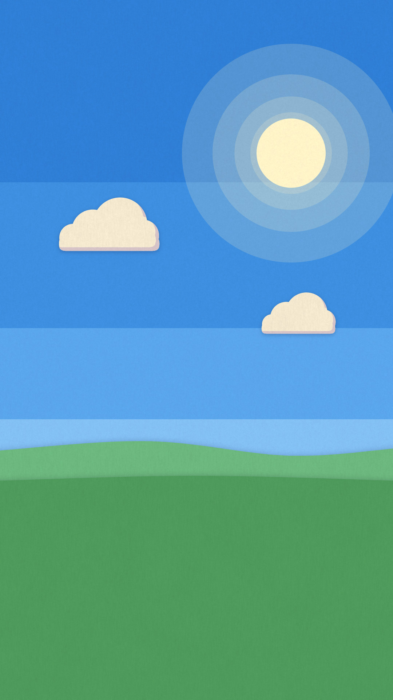
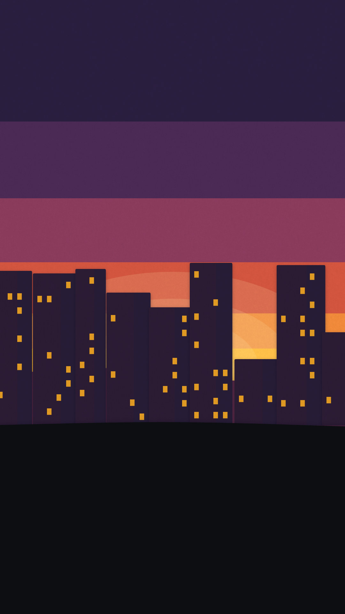
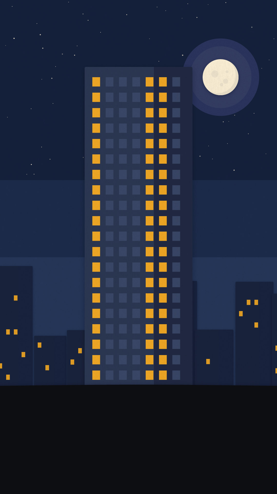
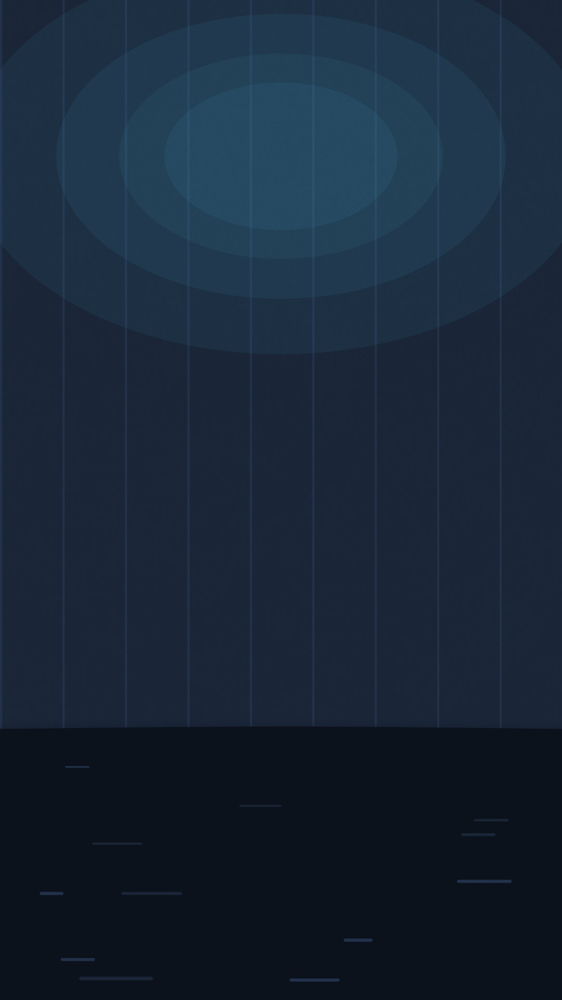

# Asset library (round 4)

Brand-consistent flat assets for That's the Mechanism. Everything here is either **original** (generated by the scripts in this folder, MIT like the repo code) or from a permissive icon set (Lucide ISC, Tabler MIT). No third-party illustrations or animations are bundled.

Full visual catalog: [`catalog.png`](catalog.png) (62 items). Palette: [`palette.json`](palette.json) (brand tokens from `remotion/src/brand/tokens.ts` plus lit/shade tones).

## Rules (flat-vector look)
- No outlines. One light from the upper left: every solid splits into a lit face and a shade face (`*D` palette tones).
- Lifted objects drop a short, soft night-blue shadow (`feDropShadow dx=6 dy=8`). Only palette colours.
- Characters are faceless and rounded (no identifiable people, ever).
- `objects/qr_generic.svg` has random modules and only finder squares: it is **not scannable**, so it is safe on screen. Never show a real, scannable QR unless you have decoded it and own the destination.

## Use in Remotion
- `build_library.py` also copies every SVG to `remotion/public/library/<name>.svg`: ``.
- Lottie: `<Lottie animationData={json} loop />` from `@remotion/lottie` (see `remotion/src/style/LottiePreview.tsx` for the fetch + delayRender pattern).
- Icons: `lucide-react` (ISC) and `@tabler/icons-react` (MIT) are installed; `icons/` has SVG exports of a curated set (`remotion/export_icons.mjs`).
- Rebuild: `python build_library.py && python build_lottie.py && python backdrops/make_backdrops.py && python make_catalog.py`.

## Licence decisions
| Source | Licence (verified at source) | Decision |
|---|---|---|
| LottieFiles free animations | "Lottie Simple License (FL 9.13.21)", https://lottiefiles.com/page/license (read 2026-11-25). Not CC0 or MIT; derivatives must carry the same licence. | **Rejected** under our CC0/MIT-only rule. We author our own Lottie JSON instead (`build_lottie.py`). |
| Lucide icons | ISC | Adopted |
| Tabler icons | MIT (`@tabler/icons-react` package.json) | Adopted |
| claude-drawing-skill (cloveric) | MIT (LICENSE, 2026) | Adopted as a **tool** for raster backdrops (see TESTS_R4.md) |

## Catalog
| thumb | file | group | licence |
|---|---|---|---|
|  | `svg/characters/office_crowd.svg` | characters | original (MIT, this repo) |
|  | `svg/characters/person.svg` | characters | original (MIT, this repo) |
|  | `svg/characters/person_phone.svg` | characters | original (MIT, this repo) |
|  | `svg/machines/balance_scale.svg` | machines | original (MIT, this repo) |
|  | `svg/machines/brake_shoe.svg` | machines | original (MIT, this repo) |
|  | `svg/machines/counterweight.svg` | machines | original (MIT, this repo) |
|  | `svg/machines/elevator_car.svg` | machines | original (MIT, this repo) |
|  | `svg/machines/gear.svg` | machines | original (MIT, this repo) |
|  | `svg/machines/tower_crane.svg` | machines | original (MIT, this repo) |
|  | `svg/machines/traction_motor.svg` | machines | original (MIT, this repo) |
|  | `svg/machines/traction_sheave.svg` | machines | original (MIT, this repo) |
|  | `svg/nature/air_molecule.svg` | nature | original (MIT, this repo) |
|  | `svg/nature/city_skyline.svg` | nature | original (MIT, this repo) |
|  | `svg/nature/cloud.svg` | nature | original (MIT, this repo) |
|  | `svg/nature/earth_flat.svg` | nature | original (MIT, this repo) |
|  | `svg/nature/eye.svg` | nature | original (MIT, this repo) |
|  | `svg/nature/sun.svg` | nature | original (MIT, this repo) |
|  | `svg/nature/wave_blue_short.svg` | nature | original (MIT, this repo) |
|  | `svg/nature/wave_red_long.svg` | nature | original (MIT, this repo) |
|  | `svg/objects/byte_block.svg` | objects | original (MIT, this repo) |
|  | `svg/objects/compact_disc.svg` | objects | original (MIT, this repo) |
|  | `svg/objects/magnifier.svg` | objects | original (MIT, this repo) |
|  | `svg/objects/qr_generic.svg` | objects | original (MIT, this repo) |
|  | `svg/objects/smartphone.svg` | objects | original (MIT, this repo) |
|  | `lottie/gear_spin.json` | lottie | original (MIT, this repo) |
|  | `lottie/pulse_ring.json` | lottie | original (MIT, this repo) |
|  | `lottie/scan_line.json` | lottie | original (MIT, this repo) |
|  | `lottie/check_pop.json` | lottie | original (MIT, this repo) |
|  | `backdrops/sky_noon.jpg` | backdrop 1080x1920 | drawn with claude-drawing-skill FlatVector (MIT code); image is our output |
|  | `backdrops/sky_sunset.jpg` | backdrop 1080x1920 | drawn with claude-drawing-skill FlatVector (MIT code); image is our output |
|  | `backdrops/city_dusk.jpg` | backdrop 1080x1920 | drawn with claude-drawing-skill FlatVector (MIT code); image is our output |
|  | `backdrops/street_wall.jpg` | backdrop 1080x1920 | drawn with claude-drawing-skill FlatVector (MIT code); image is our output |

Icons (30 SVGs): `icons/lucide/*.svg` (ISC), `icons/tabler/*.svg` (MIT): see `catalog.png`.
