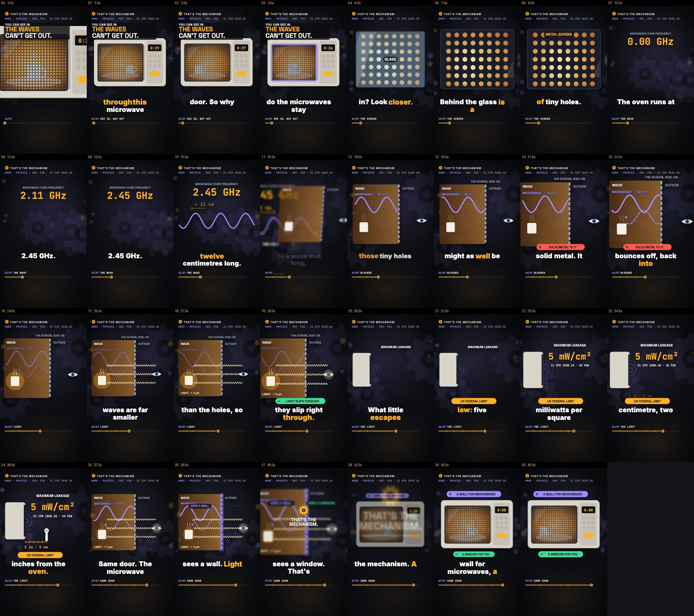

# Storyboard Microwave v1 (every 1.5s)

| # | t | spoken around this frame |
|---|---|---|
| 0 | 0.0s | You can see |
| 1 | 1.5s | straight through this microwave |
| 2 | 3.0s | door. So why do the |
| 3 | 4.5s | microwaves stay in? |
| 4 | 6.0s | Look closer. Behind |
| 5 | 7.5s | the glass is a metal screen, |
| 6 | 9.0s | full of tiny holes. |
| 7 | 10.5s | The oven runs at |
| 8 | 12.0s | 2.45 |
| 9 | 13.5s | GHz. Each wave is |
| 10 | 15.0s | about twelve centimetres |
| 11 | 16.5s | long. To a wave that |
| 12 | 18.0s | long, those tiny |
| 13 | 19.5s | holes might as well be solid |
| 14 | 21.0s | metal. It bounces |
| 15 | 22.5s | off, back into your food. |
| 16 | 24.0s | Light is different. |
| 17 | 25.5s | Its waves are far |
| 18 | 27.0s | smaller than the holes, so they |
| 19 | 28.5s | slip right through. What |
| 20 | 30.0s | little escapes is capped by |
| 21 | 31.5s | US law: |
| 22 | 33.0s | five milliwatts per square centimetre, |
| 23 | 34.5s | two inches from |
| 24 | 36.0s | the oven. Same |
| 25 | 37.5s | door. The microwave sees a |
| 26 | 39.0s | wall. Light sees a |
| 27 | 40.5s | window. That's the mechanism. |
| 28 | 42.0s | A wall for microwaves, |
| 29 | 43.5s | a window for you. |
| 30 | 45.0s |  |
